# mitre-map

mitre-map scans Sigma rules, YARA rules, Markdown reports and CSV or JSON detection catalogues for MITRE ATT&CK references and checks them: technique IDs with the wrong format, deprecated IDs from the old matrix with the technique that replaced them, a parent technique listed next to its own sub-technique, `attack.` tags that are neither tactics, techniques, groups nor software, and tactics for which nothing in the scanned set provides coverage.



**Live demo:** https://jvch0512.github.io/mitre-map/ (Synthetic data.)

PHP 8, no extensions or packages. The demo page is rendered from the tool's `--tsv` output by `scripts/site.py` (Python 3, only needed to regenerate the page).

## Use

```bash
bin/mitre-map examples
bin/mitre-map ./detections --tsv
bin/mitre-map ./detections --fail-on high       # exit 1 on any high finding
```

Exit codes: 0 ok, 1 findings at or above `--fail-on`, 2 bad input. Output is human text by default and TSV with `--tsv` (`# N files, M findings`, then `SEVERITY<TAB>RULE<TAB>WHERE<TAB>MESSAGE`).

| Rule | Severity | What it catches |
|---|---|---|
| MIT001 | high | a technique ID that is not T plus four digits, optionally followed by a dot and three digits |
| MIT002 | medium | a retired (revoked or deprecated) technique ID, with the ID that replaced it when ATT&CK names one |
| MIT003 | low | a parent technique and one of its sub-techniques both referenced in the same file |
| MIT004 | low | a tactic with no tactic tag and no known technique anywhere in the scanned set |
| MIT005 | low | an `attack.` tag that is not a tactic, technique, group or software ID |
| MIT006 | low | the pre-v18 `attack.defense-evasion` tactic, now split into stealth and defense-impairment |
| MIT007 | medium | a well-formed technique ID that does not exist in ATT&CK (low in plain text files, where it may not be an ATT&CK reference) |
| MIT000 | info | the file has no ATT&CK references |

See [examples](examples) and [docs/sample-output.txt](docs/sample-output.txt).

## Limits

- Technique IDs are recognised in Sigma `attack.tNNNN` tags anywhere, and as plain `TNNNN` IDs in files that also mention ATT&CK, MITRE, technique, tactic or TTP.
- The bundled catalogue holds about 150 common parent techniques and the 14 enterprise tactics. It is used for coverage only. An ID missing from the catalogue is not reported as unknown, so new techniques do not raise false alarms.
- Coverage is a count of references, not a measure of detection quality.
- The deprecated list covers the IDs retired in the 2020 sub-technique restructuring.

## Where it fits

Keeping the ATT&CK tags of a detection repository correct after matrix updates, and a quick coverage check before a purple team exercise.

## Tests

```bash
make test    # A PHP test script: ID parsing, deprecated mapping, every rule, coverage logic, hostile input, fuzzing and CLI exit codes
```

MIT.

## Code scanning (SARIF)

`scripts/tsv2sarif.py` converts the `--tsv` output into SARIF 2.1.0, so findings show up in GitHub code scanning:

```sh
bin/mitre-map examples --tsv | python3 scripts/tsv2sarif.py --tool mitre-map --prefix examples > results.sarif
```

Upload `results.sarif` with `github/codeql-action/upload-sarif`. Severities map to SARIF levels (critical and high to error, medium to warning, low and info to note) and to a `security-severity` score.

## Validated on real data

This tool was run on public corpora and the false positives it produced were fixed. Corpus, counts and bugs found are in [docs/validation.md](docs/validation.md).
